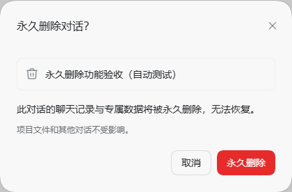

# DSH Delete Session

**在 DeepSeek Harness 桌面端，永久删除一条对话及其子代理对话。**

[English](README.en.md) · [安装](#安装) · [删除范围](#会删除什么) · [开发](#开发与验证) · [插件生态](docs/ecosystem.md)


[](https://github.com/qiaozheng9/dsh-delete-session/actions/workflows/ci.yml)

归档会保留会话数据。本项目增加应用内的 **「永久删除」**：确认范围后，停止相关任务，删除本地持久化数据，再同步清理窗口、标签页与缓存。



> **当前为实验性、本地安装的增强包。** 它由 Desktop profile 组合包与版本绑定补丁组成，需要修改本机 `app.asar` 和 Better Sidebar 客户端文件。仅支持下表中的已验证构建，不是跨版本即装即用插件。仓库不分发 DSH 安装包，也不在安装依赖时自动修改应用。

## 兼容性

| 项目 | 当前要求 |
| --- | --- |
| 系统与入口 | Windows，DeepSeek Harness Desktop，`desktop` profile |
| DeepSeek Harness | `0.2.1-rc.5`，且原始文件哈希与 [compatibility.json](compatibility.json) 完全一致 |
| Better Sidebar | `dsh-better-sidebar 0.28.0`，当前适配将其作为必要条件 |
| 开发环境 | Node.js 22 或以上、npm；运行时验证使用 DSH 自带的 Electron |
| 其他版本、CLI、独立 Web 部署 | 尚未适配 |

**版本号相同也不代表构建相同。** 构建和安装均校验 SHA-256；不匹配时拒绝继续。请勿修改哈希来绕过检查。DSH 或 Better Sidebar 升级后，需要重新审查适配。

## 使用

1. 打开普通或已归档对话的菜单，选择红色 **「永久删除」**。
2. 核对对话标题、关联子代理数量及不可恢复提示。运行中的对话显示 **「停止并永久删除」**。
3. 确认后等待清理完成。若范围在预览后发生变化，需要重新确认。

取消不会删除数据。空白、尚未持久化的对话不显示此入口。失败时显示原因和重试入口；操作不会仅通过隐藏列表项来报告成功。

## 会删除什么

| 数据 | 行为 |
| --- | --- |
| 目标对话与嵌套子代理 | 删除全部本地日志版本及其关联记录 |
| 搜索、投影与工作区记录 | 清理索引、投影缓存、归属、置顶和归档记录 |
| 工具输出与附件 | 清理专属输出；附件仅在没有其他会话或上传收据引用时回收 |
| 客户端状态 | 清理关联视图、草稿、标签页与缓存，取消 Better Sidebar 延迟写入，并通知连接中的窗口 |
| 项目文件、用户配置 | 保留 |
| 独立分支、共享附件 | 保留 |

**“独立分支保留”是什么意思？** 例如，从对话 A 的某条消息创建分支 B 后，B 就是一条独立对话。删除 A 会保留 B，以及 B 已经复制的历史。若你也要删除这份历史副本，需要单独删除 B。子代理对话则随所属目标一起清理。

旧版请求图片缓存缺少反向索引；涉及附件的删除会使这类可重建缓存失效，其他对话需要时会重新生成。日志损坏或历史依赖无法安全判断时，删除会报错，保留重试进度。

这里的“永久删除”指 **应用层文件删除与数据库记录清理**，不包含磁盘取证级擦除、其他软件的备份、独立分支中的历史副本或模型服务商的远端留存。

## 安装

### 1. 获取源码与依赖

在 PowerShell 中执行：

```powershell
git clone https://github.com/qiaozheng9/dsh-delete-session.git
cd dsh-delete-session
npm ci
```

项目的 `.npmrc` 默认使用 `https://registry.npmmirror.com`。镜像不可用时可执行 `npm ci --registry=https://registry.npmjs.org`。不需要 Python。

### 2. 指定本机路径

安装器会尝试发现桌面应用；数据目录默认使用 `$HOME/.dsh`。如果安装位置不同，可复制模板：

```powershell
Copy-Item local.config.example.json local.config.json
```

然后编辑 `local.config.json`，填写你自己的绝对路径，例如：

```json
{
  "appDir": "D:/software/DeepSeek Harness",
  "home": "D:/DSH/home"
}
```

`appDir` 是含 `DeepSeek Harness.exe` 和 `resources/app.asar` 的目录；`home` 是含 `profiles/desktop` 的 DSH 数据根目录。**不要为安装而创建另一份空白数据目录。** 原有 C 盘到 D 盘的目录联接受支持。

也可只在当前 PowerShell 会话中设置：

```powershell
$env:DSH_APP_DIR = 'D:\software\DeepSeek Harness'
$env:DSH_HOME = 'D:\DSH\home'
```

环境变量优先于本地配置；没有显式配置时，已安装项目会沿用安装记录的路径。`local.config.json` 不进入 Git。

### 3. 构建、检查与隔离验证

```powershell
npm run check
npm test
npm run build
npm run prepare:local
npm run verify:runtime
npm run verify:ui
npm run verify:install
```

`build` 读取本机安装的原始程序文件，生成本地补丁；已安装增强包时会读取安装前备份。`prepare:local` 为尚未打补丁的受支持安装生成验证用 ASAR。后三项分别验证真实存储运行时、浏览器交互，以及临时目录中的安装／卸载，不删除已有真实对话。

界面验证使用已安装的 Edge 或 Chrome；如未自动找到，可设置 `$env:DSH_TEST_BROWSER` 为 Chromium 浏览器可执行文件的绝对路径。

### 4. 退出桌面应用并安装

从托盘菜单**完全退出**待安装的 DeepSeek Harness，随后运行：

```powershell
npm run install:local
npm run status
```

安装器备份程序文件与 profile 配置，写入增强包，再应用经哈希验证的补丁。它不会强制终止应用。重新启动 DSH 后即可使用。

**请保留此仓库目录和 `.local/`。** 默认备份位于 `.local/backup/`，安装记录位于 `.local/installed.json`；profile 的本地依赖也指向本项目生成的组合包。备份不包含被删除的会话。

## 检查、卸载与升级

```powershell
npm run status
npm run uninstall:local
```

卸载前完全退出桌面应用。卸载会验证程序、备份和受跟踪的插件文件，恢复应用与侧栏文件，并从 profile 移除本增强包，保留安装后的其他配置修改。**卸载不能恢复已删除的对话。** 有未完成的删除时，须先启动应用重试完成。

升级 DSH 或 Better Sidebar 前，建议先卸载增强包。升级后如检查失败，安装器会拒绝覆盖未知文件；不要强行恢复旧版 `app.asar` 或重打旧补丁。

## 一致性与隐私

- 删除服务只接收会话 ID，服务端解析删除范围与路径；客户端不能提交文件路径。
- 删除前阻止新的提示、恢复与派生，停止相关任务，等待写入器关闭，并取得存储排他锁。其他进程占用时返回错误。
- 路径解析限制在实际数据根目录内；允许根目录自身是目录联接，拒绝通过下层链接越界。
- 清理日志只保存必要标识与引用，不复制消息正文；启动时恢复未完成删除，再开放相关会话。
- 全部清理完成才发送成功事件。完成后保留无消息正文的删除回执，防止延迟消息重建对话，并帮助离线窗口重连时清理状态。

该项目的删除逻辑不向外部上传会话。公开仓库不包含本机安装包、程序备份、提取的上游模块、安装状态或用户对话数据。

## 开发与验证

不安装 DSH 也能完成源码检查、核心测试及组合包编译：

```powershell
npm ci
npm run check
npm test
npm run build:plugin
```

`build:plugin` **只生成运行时组合包**，不会生成或安装 DSH 所需补丁。GitHub Actions 在 Windows／Linux、Node.js 22／24 上执行这些检查；Linux CI 通过不代表支持 Linux 桌面安装。

完整集成验证需要兼容的本机 DSH 和 Better Sidebar。核心与隔离测试覆盖子代理、独立分支、共享引用、缺失文件、锁冲突、并发变更、中断重试和路径链接边界；真实桌面测试需要额外执行：

```powershell
# 先完全退出已安装并启用增强包的桌面应用
npm run verify:installed
```

此命令会启动真实桌面应用，创建一条明确标记的验收对话，通过原生菜单删除它，最后退出应用。它使用当前 profile，**不要把它当作普通单元测试自动运行**。

| 目录 | 用途 |
| --- | --- |
| `src/` | 删除引擎、存储适配、运行保护及原生弹窗 |
| `plugin/` | 运行时组合包 manifest 与配置层 |
| `scripts/` | 构建、版本绑定补丁、安装器与验证脚本 |
| `tests/` | 隔离的核心、路径、标题与 ASAR 测试 |
| `compatibility.json` | 已审查构建的原始文件哈希 |
| `.local/`、`.reference/`、`dist/` | 本机状态、上游参考与生成产物；不提交 |

部分适配涉及 DSH 私有运行时接口，尚不能依靠公开类型完整检查；对应模块保留 `@ts-nocheck`，需以版本校验及集成验证补足。贡献方式见 [CONTRIBUTING.md](CONTRIBUTING.md)。

## 插件生态与后续方向

项目可以公开展示、被社区目录发现，也提供标准组合包的源码元数据。但目前仍需要手动运行本地补丁安装器，**不应直接宣传为可从插件市场一键安装的通用插件**。仓库地址也不能直接替代完整安装流程。

标准生态分发需要先解决受支持存储删除接口与生命周期保护的交付，再提供独立可安装产物和明确的版本声明。官方插件市场机制、当前限制及后续接入条件见 [插件生态说明](docs/ecosystem.md)。

## 许可证与归属

[MIT](LICENSE)。本项目为独立社区增强，与 DeepSeek 官方无隶属关系。DeepSeek Harness、Better Sidebar 与各依赖的归属和许可证见 [NOTICE.md](NOTICE.md)。
